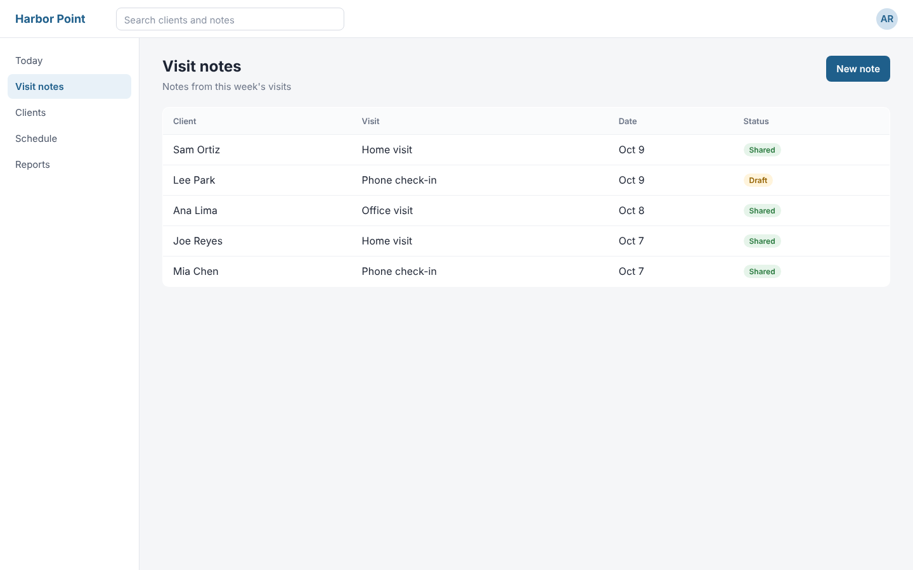
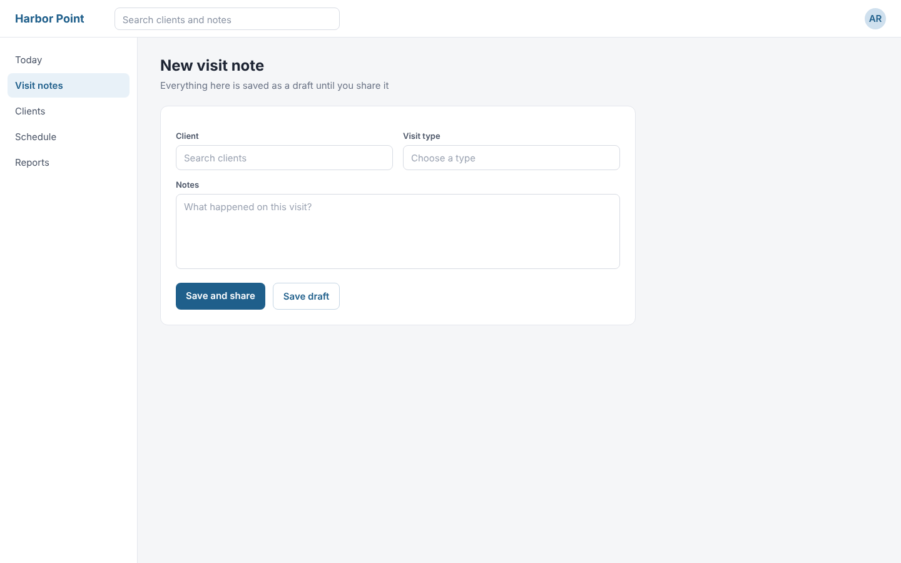
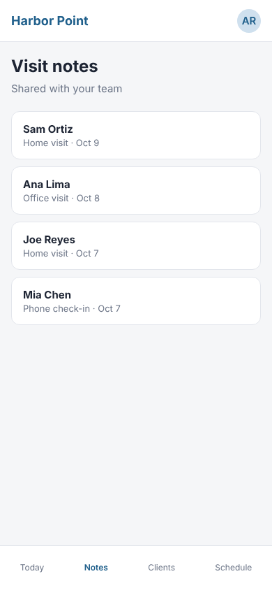

:::: {.scene .title #open name="Harbor Point"}
[Product walkthrough · Illustrative demo]{.eyebrow}

# Write a visit note in *four steps* {.xl}
::::

:::: {.scene .app #meet name="Meet the app"}
{.screen}

## Meet Harbor Point

[Every visit note your team writes, in one list.]{.sub}

[Visit notes]{.focus zoom=1.5}

[]{.back}
::::

:::: {.scene .step #start}
## Start a note

[New notes start from the list you already work in.]{.sub}

[New note]{.click zoom=1.6 sfx=click}
::::

:::: {.scene .step #write}
{.screen}

## Write it once

[Pick the client and the visit, then type what happened.]{.sub}

[Sam Ortiz]{.fill field="Client" zoom=1.6}

[Home visit]{.choose field="Visit type"}

[Talked through the new schedule and next week's visit.]{.fill field="Notes" zoom=1.4}
::::

:::: {.scene .step #share}
## Share it with the team

[One click saves the note and shares it.]{.sub}

[Save and share]{.click zoom=1.6 sfx=click}

[Save and share]{.wait}

[Note shared with your team]{.toast sfx=pop}
::::

:::: {.scene .step #phone screen=phone}
{.screen}

## Read it anywhere

[The same note, on the phone, for the next visit.]{.sub}

[Sam Ortiz]{.focus zoom=1.8}
::::

:::: {.scene .closing #close name="Get started"}
## Visit notes, written once and shared.

[Start at harborpoint.example.com]{.cta}

{.grow at=1.2 sfx=chime}

[Illustrative demo: Harbor Point and its data are fictional.]{.note}
::::
